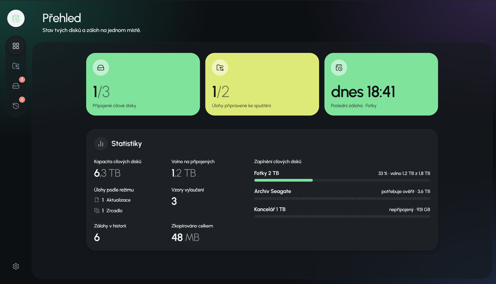

# Data Backup Studio

[Česká verze](README.md)

Offline Windows desktop app for backing up folders from your PC to external USB drives.

- **Set rules once** – what to back up, where, and which mode (Mirror / Update).
- **Drive letters do not matter** – each USB disk is identified by its own identity, whether it is `F:` one day and `G:` the next.
- **Plain files** – backups are normal folders you can open without the app.
- **Safety first** – preview before run, guards against accidental mass deletes, no network.



## Getting started

1. **Register a target USB disk** on the Disks screen. A hidden marker is written to the disk root so the app recognizes it after letter changes.
2. **Create a job** – pick a source folder, target disk and folder, and mode (Mirror = exact copy including deletes; Update = new and changed files only, nothing deleted). Mirror keeps existing target files that already match size and time.
3. **Run a backup** from Overview or a job card. You always see a preview (keep / copy / delete) before the run starts. You can minimize the run and keep using the app; additional jobs queue one at a time.

Configuration and run history live only in `%APPDATA%\app.databackupstudio\` (jobs, disks, `history.db`, logs). The backup disk holds only your copied folders and the `.databackupstudio` marker.

License: [MIT](LICENSE).

## Documentation
- [Architecture and stack](docs/ARCHITECTURE.md) (Czech)
- [Roadmap](docs/ROADMAP.md) (Czech)
- [UI/UX guidelines](docs/UI-UX.md) (Czech)
- [Architecture decisions (ADR)](docs/decisions/README.md)
- [Changelog](CHANGELOG.md) (Czech)

## Development
Requirements: Windows 10/11, Rust stable, Node.js 22+, pnpm, WebView2.

```powershell
pnpm install
pnpm tauri dev      # development
pnpm check          # lint + types + clippy + rustfmt
pnpm test           # frontend tests
cargo test --workspace
```

Offline installer build: `.cursor/skills/release-offline/SKILL.md`.
