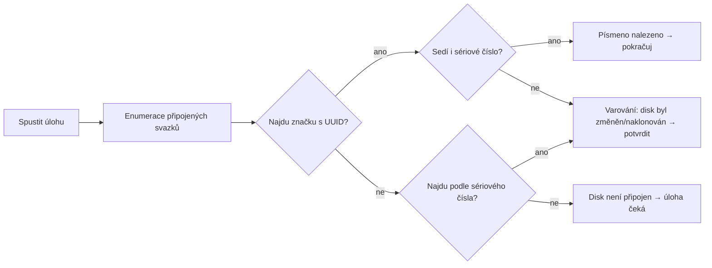

# Architektura – Data Backup Studio

Desktopová aplikace pro Windows na zálohování složek z interních disků na externí USB disky.
Pravidla (úlohy) se nastaví jednou, pak se záloha jen spouští. Cesty **nejsou vázané na písmeno
jednotky** – disky se identifikují podle vlastní identity, takže změna `F:` → `G:` nic nerozbije.

## 1. Požadavky (shrnutí)

| Oblast | Rozhodnutí |
|---|---|
| Platforma | Windows 10/11, nativní desktop aplikace, 100 % offline |
| Režimy zálohy | **Zrcadlo** (cíl = přesná kopie, maže se) a **Aktualizace** (jen nové/změněné, nic se nemaže) |
| Spouštění | Ručně (jedna úloha / vybrané / všechny) |
| Formát zálohy | Obyčejné soubory 1:1 – čitelné i bez aplikace |
| Jazyk UI | Čeština |
| Design | Material Design 3, minimalistický, světlý/tmavý režim |

## 2. Technologický stack

| Vrstva | Technologie | Proč |
|---|---|---|
| Aplikační shell | **Tauri 2** | Malý instalátor (~10 MB), nízká RAM, nativní okno přes WebView2, žádný server, žádná síť |
| Backend / engine | **Rust (stable)** | Rychlost blízká C, bezpečnost paměti, snadný paralelismus, přímý přístup k Win32 API |
| Win32 API | crate `windows` | Enumerace svazků, sériová čísla, GUID svazků, volné místo |
| Procházení disku | `jwalk` (paralelní walk) | Rychlé skenování stovek tisíc souborů |
| Paralelní kopírování | `rayon` / omezený pool vláken | Konfigurovatelný počet souběžných kopií (USB HDD vs. SSD) |
| Filtry | `globset` | Vyloučení např. `**/node_modules/**`, `*.tmp` |
| Hashování (volitelné ověření) | `blake3` | Nejrychlejší kryptografický hash |
| Časy souborů | `filetime` | Zachování mtime u kopií |
| Konfigurace | JSON (`serde_json`) v `%APPDATA%` | Čitelné, snadno zálohovatelné, export/import |
| Historie běhů | SQLite (`rusqlite`, bundled) | Rychlé dotazy na historii a chyby |
| Logování | `tracing` + rotace do souborů | Diagnostika |
| Typy Rust ↔ TS | `tauri-specta` | Typově bezpečné příkazy, TS typy generované z Rustu |
| Frontend | **React 19 + TypeScript (strict) + Vite** | Ekosystém, rychlý vývoj |
| UI knihovna | **MUI (Material UI)** s vlastním M3 tématem | Hotové přístupné komponenty v Material Designu |
| Datová vrstva UI | TanStack Query (volání backendu) + Zustand (stav UI) | Jasné oddělení serverového a lokálního stavu |
| Routing | React Router | Jednoduché obrazovky |
| Písma / ikony | `@fontsource-variable/urbanist`, `lucide-react` | Vše přibalené – žádný CDN, funguje offline |
| Lint / formát | `clippy`, `rustfmt`, **Biome** (TS) | Rychlé, jeden nástroj pro TS lint + format |
| Testy | `cargo test` (+ `tempfile`), Vitest + Testing Library | Engine testován na reálném FS v dočasných složkách |
| Balíčkovač | pnpm (lockfile) | Reprodukovatelné buildy |
| Instalátor | NSIS (+ přibalený offline WebView2) a portable `.exe` | Instalovatelné i za 10 let bez internetu |

### Proč ne webová aplikace v prohlížeči
Prohlížeč nesmí volně číst/zapisovat po disku ani zjistit sériové číslo svazku. Potřebovali bychom
stejně lokální server, který by běžel na pozadí a otevíral port – víc kódu, horší bezpečnost.
Tauri dává totéž webové UI, ale bez serveru a s nativním přístupem k systému.

## 3. Struktura repozitáře

```
Data-backup-studio/
├─ AGENTS.md                 # vstupní bod pro AI – kontext, pravidla, kde co je
├─ CHANGELOG.md              # paměť projektu – co se kdy změnilo
├─ README.md
├─ docs/
│  ├─ ARCHITECTURE.md        # tento dokument
│  ├─ ROADMAP.md             # fáze, stav úkolů (živý dokument)
│  ├─ UI-UX.md               # design systém, obrazovky, UX zásady
│  └─ decisions/             # ADR – zaznamenaná architektonická rozhodnutí
├─ .cursor/
│  ├─ rules/                 # pravidla pro AI (.mdc)
│  └─ skills/                # postupy pro AI (SKILL.md)
├─ crates/
│  └─ backup-core/           # čistá Rust knihovna: doména, engine, svazky, úložiště
│     ├─ src/domain/         # Job, VolumeRef, Mode, Filter… (žádné I/O)
│     ├─ src/volumes/        # enumerace a identifikace disků (Win32)
│     ├─ src/engine/         # scan → diff → plan → execute
│     ├─ src/storage/        # config.json, history.db
│     └─ tests/              # integrační testy na dočasných složkách
├─ src-tauri/                # tenký shell: Tauri příkazy, události, okno
│  ├─ src/commands/          # 1 soubor = 1 oblast (jobs, volumes, runs, settings)
│  ├─ capabilities/          # minimální oprávnění pro frontend
│  └─ tauri.conf.json
└─ src/                      # React frontend
   ├─ app/                   # providers, router, téma
   ├─ features/              # jobs/, volumes/, runs/, history/, settings/
   ├─ components/            # sdílené UI komponenty
   ├─ lib/                   # bindings.ts (generované), utils
   └─ main.tsx
```

Pravidlo: **veškerá logika v `backup-core`**, `src-tauri` jen překládá příkazy a události.
Díky tomu je engine testovatelný bez UI a bez Tauri.

## 4. Klíčový problém: měnící se písmena disků

### Identita disku (VolumeRef)
Každý disk má v aplikaci záznam s několika nezávislými identifikátory:

1. **Značkový soubor** `X:\.databackupstudio\volume.json` s vlastním UUID – zapíše se při
   registraci cílového disku. Přežije i připojení k jinému PC. **Primární identita cílů.**
2. **Sériové číslo svazku** (`GetVolumeInformationW`) – mění se jen při formátování.
3. **GUID svazku** `\\?\Volume{…}\` – stabilní na tomto PC.
4. Jmenovka a velikost – jen pro zobrazení a kontrolu.

Zdrojové (interní) disky se identifikují sériovým číslem + GUID (do kořene `C:\` se nezapisuje).

### Ukládání cest
Úloha neukládá `F:\Zaloha\Fotky`, ale `{ volumeId: "…", relPath: "Zaloha\\Fotky" }`.
Písmeno se dohledá **při každém spuštění**:



UI průběžně ukazuje, které registrované disky jsou připojené a pod jakým písmenem.

### Implementace (fáze 2)
- `volumes/win.rs` – jediné místo s `unsafe`: `FindFirstVolumeW`, `GetVolumePathNamesForVolumeNameW`,
  `GetVolumeInformationW`, `GetDiskFreeSpaceExW`, `GetDriveTypeW` a `IOCTL_STORAGE_QUERY_PROPERTY`
  (typ sběrnice USB/SATA/NVMe a model disku; bez admin práv).
- `volumes/marker.rs` – čtení/zápis značky (atomicky, složka skrytá).
- `volumes/resolve.rs` – čistá funkce `resolve()` a `overview()`; stavy `connected`,
  `needsConfirmation` (`serialChanged`, `markerMissing`, `duplicate`), `disconnected`.
- `volumes/registry.rs` – registrace, přejmenování, odebrání, potvrzení disku.
- `storage/config.rs` – `ConfigStore.update()` je transakční: změna na kopii → atomický zápis → teprve pak v paměti.
- Příkazy dostávají `guid_path`/`id`, nikdy cestu; svazek se vždy dohledá v čerstvé enumeraci.
- UI obnovuje seznam disků každé 4 s (jen když je okno aktivní).

### Implementace úloh (fáze 3)
Podrobně v [ADR 0005](decisions/0005-job-locations.md).
- `domain/location.rs` – `Location`, normalizace relativní cesty, test „leží uvnitř“ (bez ohledu na velikost písmen).
- `domain/job.rs` – `Job`, `BackupMode`, `JobSpec::validate()` (název, cesty, cíl není kořen, překryv, `globset`).
- `jobs/locate.rs` – absolutní cesta z dialogu → svazek + relativní cesta (`LocatedFolder`), nic neukládá.
- `jobs/mod.rs` – vytvoření/úprava/smazání úlohy, zapamatování zdrojových disků (`config.sources`),
  zákaz překryvu cílových složek, zákaz odebrání disku používaného úlohou, `JobView` pro UI.

## 5. Záložní engine

Průběh jedné úlohy:

1. **Preflight** – dohledat zdroj i cíl, ověřit přístup, cíl není uvnitř zdroje (a naopak),
   cíl není systémová složka, odhad potřebného místa.
2. **Scan** – paralelně projít zdroj i cíl → mapy `relPath → (velikost, mtime, atributy)`.
3. **Diff → plán** – akce `CreateDir`, `Copy` (nový), `Update` (změněný), `Delete` (jen Zrcadlo).
   Změna = jiná velikost nebo mtime mimo toleranci (2 s kvůli FAT32/exFAT a letnímu času).
4. **Náhled plánu** – počty a objem (zkopíruje 1 204 souborů / 38 GB, smaže 12) → potvrzení.
5. **Execute** – kopie do `název.dbs-partial`, po dokončení atomické přejmenování a nastavení
   mtime. Nedokončená kopie nikdy nepřepíše platný soubor.
6. **Report** – souhrn do `history.db`, detailní log do souboru, chyby (zamčené soubory,
   přístup odepřen) se sbírají a úloha pokračuje.

### Bezpečnostní pojistky (Zrcadlo maže!)
- Pokud je zdrojová složka prázdná/nedostupná → **přerušit**, nikdy nemazat cíl.
- Pokud by se smazalo víc než nastavený práh (výchozí 20 % souborů cíle) → vyžádat výslovné potvrzení.
- Mazání se provádí až po úspěšném kopírování.
- Symlinky a junction body se nenásledují (ochrana proti smyčkám a úniku mimo zdroj).
- Dlouhé cesty přes prefix `\\?\` (nad 260 znaků).

### Výkon
- Paralelní scan, konfigurovatelný počet souběžných kopií (výchozí 4; USB HDD méně, SSD více).
- Velké soubory kopírovány přes `CopyFileExW` (nativní, rychlé, s průběhem).
- Události o průběhu omezené na ~10/s, aby UI nezahlcovaly.
- Zrušení běhu kdykoli (bezpečně – rozpracovaná `.dbs-partial` se uklidí).

## 6. Bezpečnost

- **Žádná síť**: aplikace nemá updater, telemetrii ani vzdálené zdroje; CSP zakazuje externí URL.
- **Minimální oprávnění Tauri**: frontend nemá přímý přístup k souborovému systému. Smí jen
  volat definované příkazy a otevřít dialog pro výběr složky. Všechny cesty validuje Rust.
- Validace vstupů v backendu (relativní cesty bez `..`, kanonizace, kontrola překryvu zdroj/cíl).
- Bez admin práv – běží jako běžný uživatel.
- Závislosti zamčené (`Cargo.lock`, `pnpm-lock.yaml`), `cargo audit` / `pnpm audit` v release postupu.

## 7. Offline navždy

- Release build = NSIS instalátor s přibaleným offline WebView2 + portable `.exe`.
- Instalátor se archivuje v `releases/` (mimo git) a doporučeně i na každém zálohovacím disku.
- Konfigurace je v `%APPDATA%\app.databackupstudio\config.json` (+ `config.json.bak` s předchozí
  verzí) a půjde exportovat do souboru.
- Volitelně `cargo vendor` + pnpm store pro build bez internetu (viz skill `release-offline`).

## 8. Datový model (zjednodušeně)

```rust
struct RegisteredVolume { id: VolumeId, name, serial: u32, guid_path, file_system, model, total_bytes, … } // cíl se značkou
struct SourceVolume     { id: VolumeId, name, serial: u32, guid_path }                                  // zdroj bez značky
struct Location { volume_id: VolumeId, rel_path: String }   // "Zaloha\\Fotky", nikdy písmeno
struct Job      { id: JobId, name, source: Location, target: Location,
                  mode: Mirror | Update, excludes: Vec<String>, created_at_ms, updated_at_ms }
struct Run      { id, job_id, started, finished, status, copied, updated, deleted, bytes, errors }
```
